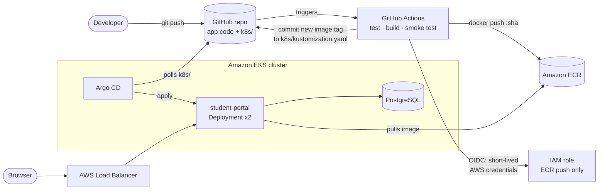
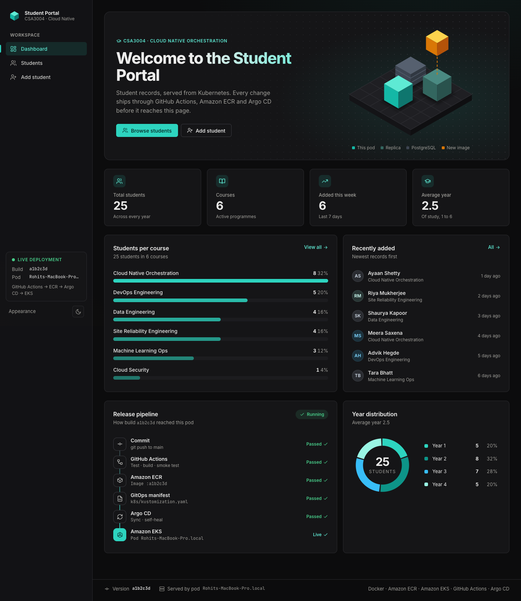
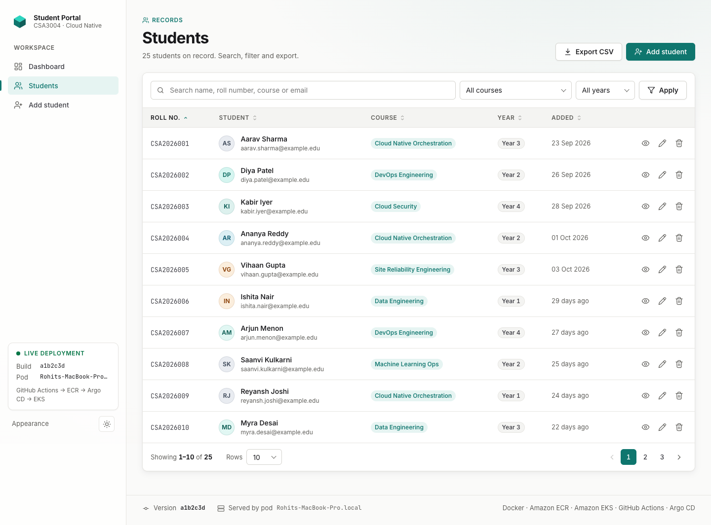
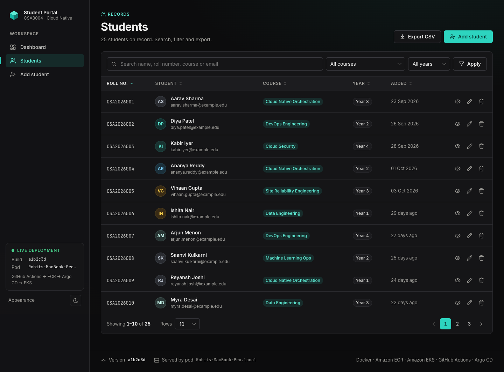
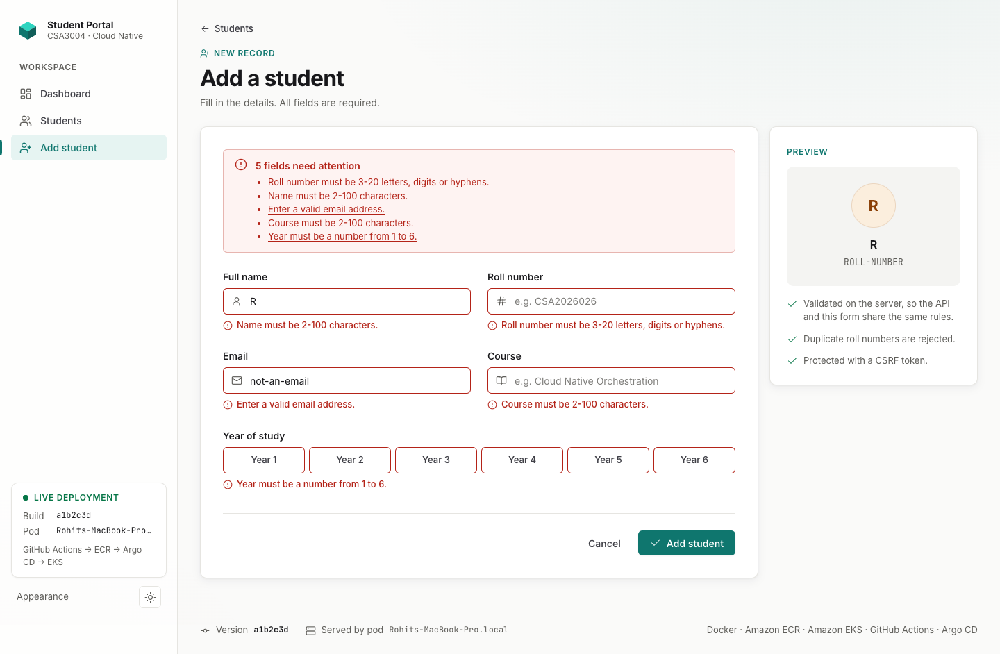
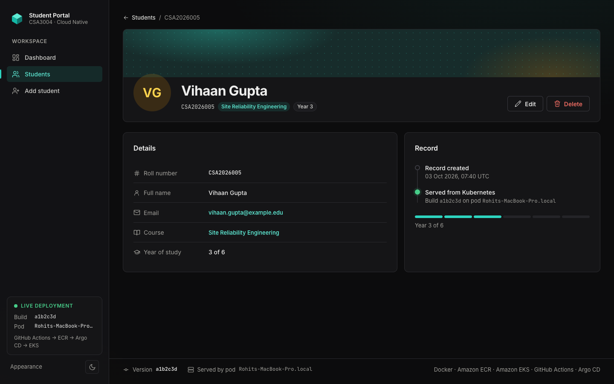
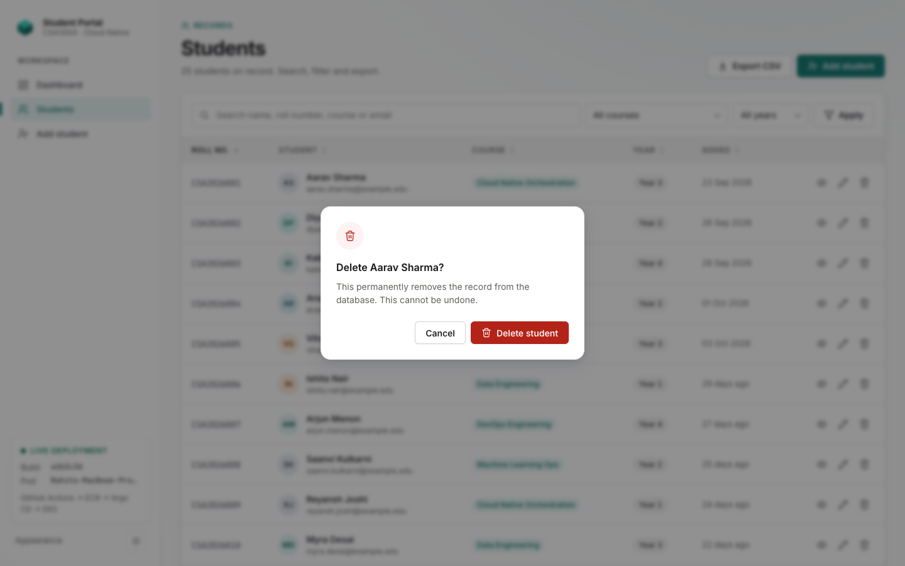
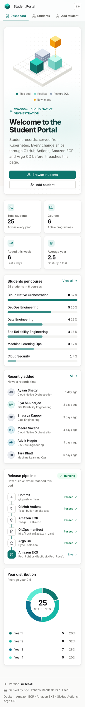
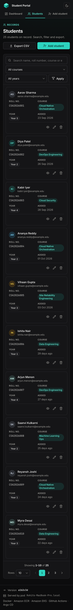

# Student Information System on Amazon EKS (GitHub Actions + Argo CD GitOps)

A small Flask web application that manages student records, packaged as a Docker image, stored in Amazon ECR and deployed to Amazon EKS. GitHub Actions tests, builds and publishes every change; Argo CD watches the Kubernetes manifests in this repository and keeps the cluster in sync (GitOps).

```
Developer → GitHub → GitHub Actions → Docker image → Amazon ECR → Git deployment config (k8s/) → Argo CD → Amazon EKS → Running app
```

## Architecture



Key design decisions:

| Decision | Why |
|---|---|
| **Pull-based GitOps** (Argo CD pulls from Git) | GitHub Actions never gets cluster credentials. The cluster state is whatever Git says, so every deploy is an auditable commit and rollback is `git revert`. |
| **GitHub OIDC → IAM role** | No long-lived AWS access keys stored in GitHub. The role can be assumed only by this repo's `main` branch and can only push to one ECR repository. |
| **Immutable image tags = git SHA** | Each running pod maps to an exact commit. ECR tag immutability stops a tag being overwritten. |
| **Build once, test, push the same image** | The image that passed the smoke test is the one pushed; there is no rebuild between test and release. |
| **Kustomize `images:` block** | CI edits one field (`newTag`) with `yq`; no fragile `sed` on YAML. |
| **App code and manifests in one repo** (`k8s/` directory) | Simpler for this assignment, and explicitly allowed. `paths-ignore` stops manifest commits from re-triggering CI. A separate config repo is the usual next step for larger teams. |
| **Hardened pods** | Non-root UID, read-only root filesystem, all Linux capabilities dropped, seccomp, resource limits, startup/readiness/liveness probes, PodDisruptionBudget, zero-downtime rolling updates. |

## Application features


| Feature | Where |
|---|---|
| **Dashboard**: KPI cards, students-per-course bars, year donut, release pipeline, recent activity (charts are server-rendered inline SVG, no chart library) | `/` |
| **Students list**: server-side search, course and year filters, sortable columns, pagination with page size, empty states | `/students` |
| **CSV export** of the current filtered list (formula-safe cells) | `/students/export.csv` |
| **Student detail** page | `/students/<id>` |
| **Add / edit** with inline validation, an error summary, preserved input and a live preview | `/students/new`, `/students/<id>/edit` |
| **Delete** with an accessible `<dialog>` confirmation (no browser `confirm()`) | Delete buttons |
| **Toast notifications** for flash messages (`aria-live`) | Every page |
| Light and dark themes (follows the OS, toggle remembered), keyboard navigation, reduced-motion support, mobile layout at 375px | Every page |
| Friendly **404 / 500** pages; JSON errors on API paths | Any missing route |
| Original JSON API, unchanged | `GET/POST /api/students`, `GET/DELETE /api/students/<id>` |
| **Versioned API** with pagination envelope (`?q=&course=&year=&sort=&order=&page=&per_page=`), `PUT`, and `{"error": {"code", "message", "fields"}}` errors | `/api/v1/students`, `/api/v1/students/<id>` |
| Dashboard numbers as JSON | `GET /api/v1/stats` |
| Health and version endpoints for Kubernetes probes and demos | `/healthz` (liveness), `/readyz` (DB check), `/version` |

Security and operations: a self-only Content-Security-Policy (fonts, icons and scripts are all served from `app/static/`, nothing from a CDN), `X-Content-Type-Options`, `X-Frame-Options`, `Referrer-Policy`, `Permissions-Policy`, CSRF on every form, and structured JSON logs with an `X-Request-ID` that is accepted or generated and echoed back.

<details>
<summary>More screenshots (light, dark, mobile)</summary>

| | |
|---|---|
|  |  |
|  |  |
|  |  |
|  |  |

</details>

The sidebar deployment badge and the page footer show the **running version (git SHA)** and the **pod name**, which makes the end-to-end demo easy to see: after a push, the footer changes to the new SHA, and refreshing shows requests spread across pods.

Tech stack: Python 3.12, Flask 3, SQLAlchemy, Flask-WTF (CSRF protection), Gunicorn, PostgreSQL 17 (in-cluster) or SQLite (local/tests). The UI is server-rendered Jinja with a small vanilla-JS file and no build step; Inter and JetBrains Mono are self-hosted.

## Repository layout

```
.
├── app/                     Flask app: routes/ (thin) → services/ (logic) → models; templates, static
├── tests/                   pytest tests (66 tests, ~99% coverage)
├── Dockerfile               Multi-stage, non-root image
├── gunicorn.conf.py         Production server settings
├── k8s/                     ← GitOps deployment config watched by Argo CD
│   ├── kustomization.yaml   CI updates the image tag here
│   ├── deployment.yaml      Web app (2 replicas, probes, security context)
│   ├── service.yaml         LoadBalancer (public endpoint)
│   ├── postgres.yaml        In-cluster PostgreSQL
│   └── pdb.yaml             PodDisruptionBudget
├── argocd/application.yaml  Argo CD Application (automated sync, prune, self-heal)
├── .github/workflows/ci-cd.yml
├── infra/                   Numbered setup scripts for EC2, ECR, OIDC, EKS, Argo CD, teardown
└── docs/
    ├── RUNBOOK.md           Step-by-step setup (assignment tasks 1-7)
    └── DEMO.md              End-to-end demonstration script + evidence checklist
```

## Run locally

```bash
python3 -m venv .venv && source .venv/bin/activate
pip install -r requirements-dev.txt
make test          # ruff-clean code, 66 tests
make run           # http://localhost:8080 (SQLite in /tmp)

# Or in Docker
make docker-build && make docker-run
```

## Deploy to AWS

Follow **[docs/RUNBOOK.md](docs/RUNBOOK.md)**. In short:

```bash
cp infra/config.env.example infra/config.env      # set GITHUB_OWNER, region, names
bash infra/00-ec2-bootstrap.sh                     # on the Ubuntu EC2 admin box
bash infra/01-create-ecr.sh
bash infra/02-github-oidc-role.sh                  # prints the 3 GitHub variables to set
bash infra/03-create-eks-cluster.sh                # or: --existing for a provided cluster
bash infra/04-bootstrap-app-secrets.sh
# run the GitHub Actions pipeline once, then: git pull
bash infra/05-install-argocd.sh
```

Then follow **[docs/DEMO.md](docs/DEMO.md)** for the end-to-end demonstration.

## CI/CD pipeline

`.github/workflows/ci-cd.yml` runs on every push to `main` (app code changes), on pull requests, and manually.

| Job | What it does | Runs on PRs? |
|---|---|---|
| `test` | Checkout, install deps, `ruff check`, `ruff format --check`, `pytest` with coverage | Yes |
| `build-and-push` | Build the image (tag = short SHA, version baked in), start it and smoke-test `/healthz`, `/` and `/api/students`; then assume the AWS role via OIDC, log in to ECR and push the tested image; report the ECR scan result | Build and smoke test only |
| `update-manifest` | Set `newName`/`newTag` in `k8s/kustomization.yaml` with `yq` and commit `deploy: student-portal <sha>` back to `main` | No |

GitHub repository **variables** required (identifiers, not secrets): `AWS_ROLE_ARN`, `AWS_REGION`, `ECR_REPOSITORY`. No GitHub secrets are needed.

## Security notes

- No AWS keys anywhere: EC2 uses an instance role; GitHub uses OIDC.
- The OIDC trust policy is pinned to `repo:<owner>/<repo>:ref:refs/heads/main`, so forks and other branches cannot assume the role.
- Application secrets (DB password, Flask secret key) are generated on the cluster by `infra/04-bootstrap-app-secrets.sh` and never committed.
- Argo CD UI is reached via `kubectl port-forward` over SSH, not exposed publicly.

## Production hardening (out of scope for the assignment)

- Replace in-cluster PostgreSQL (emptyDir storage) with **Amazon RDS**, or use an EBS-backed PersistentVolumeClaim with the EBS CSI driver.
- Use **External Secrets Operator** with AWS Secrets Manager instead of a manually created Secret.
- Use the **AWS Load Balancer Controller** with an Ingress/ALB and ACM certificate for HTTPS.
- Move `k8s/` to a separate config repository with branch protection and PR-based promotion between environments.
- Add image signing (cosign) and admission policy (Kyverno) to allow only signed ECR images.

## Clean up

```bash
bash infra/99-teardown.sh   # deletes the LB, EKS cluster, ECR repo and GitHub role
```
Then stop or terminate the EC2 admin instance. EKS, NAT gateway, worker nodes and the load balancer all bill by the hour.
