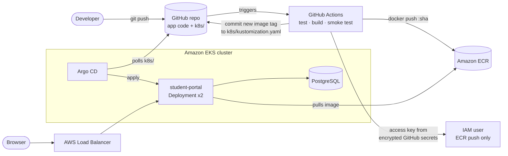
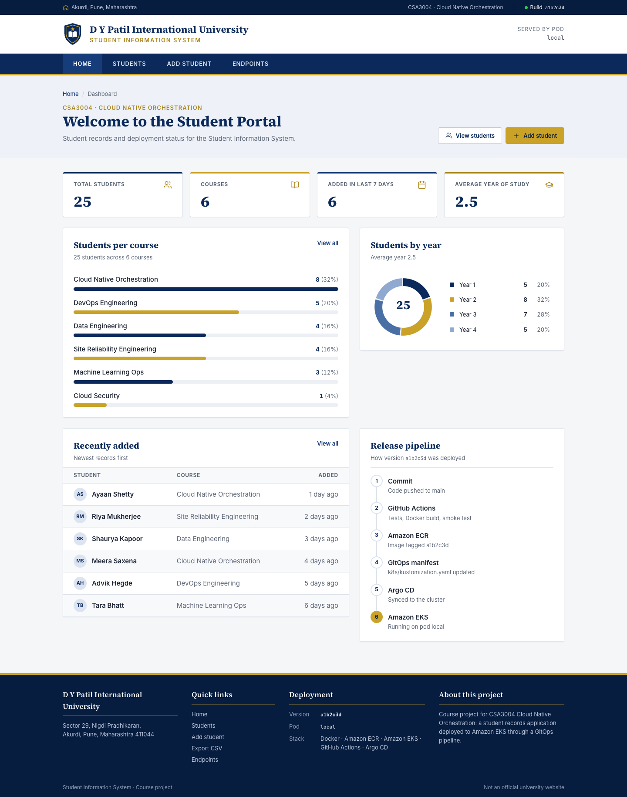
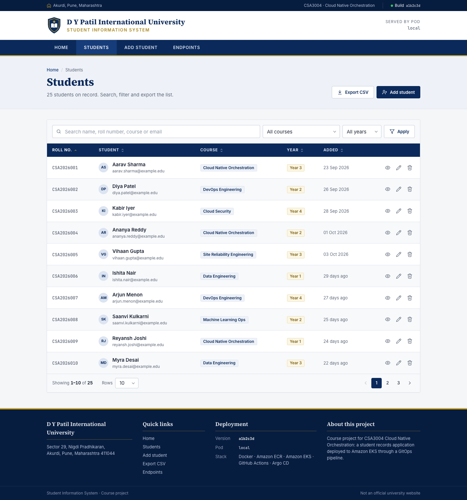
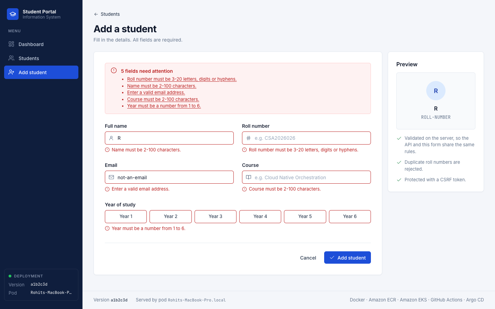
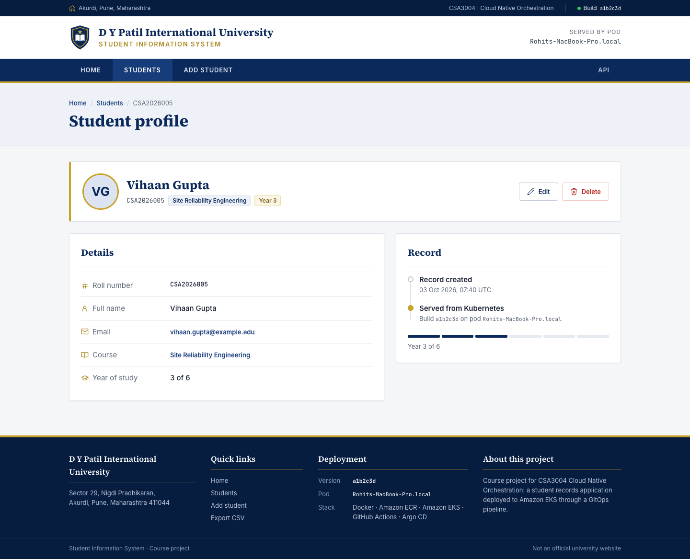
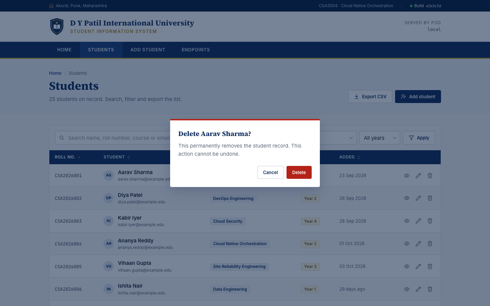
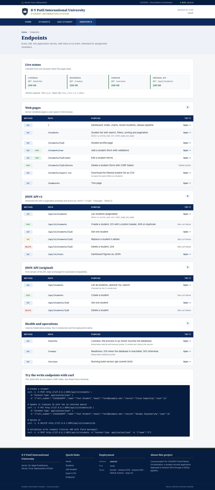
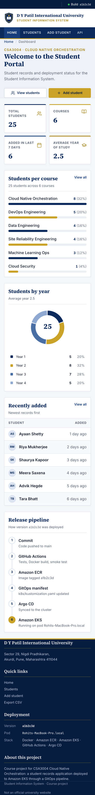

# Student Information System on Amazon EKS (GitHub Actions + Argo CD GitOps)

A small Flask web application that manages student records, packaged as a Docker image, stored in Amazon ECR and deployed to Amazon EKS. GitHub Actions tests, builds and publishes every change; Argo CD watches the Kubernetes manifests in this repository and keeps the cluster in sync (GitOps).

```
Developer → GitHub → GitHub Actions → Docker image → Amazon ECR → Git deployment config (k8s/) → Argo CD → Amazon EKS → Running app
```

## Architecture



Deployed environment:

| Item | Value |
|---|---|
| AWS region | `ap-southeast-2` (Sydney) |
| EKS cluster | `student-portal-eks`, Kubernetes 1.35, created with `eksctl` |
| Worker nodes | Managed node group of **3 × `t3.small`** (free-tier-eligible type) in private subnets, one NAT gateway |
| Container registry | Amazon ECR repository `student-portal` (immutable tags, scan on push) |
| CI credentials | Dedicated IAM user that can only push to that ECR repository (AWS Free plan fallback, see below) |
| GitOps | Argo CD v3.5.7, automated sync, prune and self-heal |
| Public endpoint | Kubernetes `LoadBalancer` Service, which provisions an AWS load balancer |

Key design decisions:

| Decision | Why |
|---|---|
| **Pull-based GitOps** (Argo CD pulls from Git) | GitHub Actions never gets cluster credentials. The cluster state is whatever Git says, so every deploy is an auditable commit and rollback is `git revert`. |
| **Scoped IAM user for CI** (AWS Free plan fallback) | The preferred design is GitHub OIDC with no stored keys, but AWS Free plan accounts block IAM OIDC identity providers with a service control policy. So GitHub Actions authenticates as a dedicated IAM user whose only permission is pushing to the one ECR repository. Its access key is kept in encrypted GitHub secrets, so a leaked key cannot touch the cluster or anything else. The workflow still supports OIDC: on a normal account, run `infra/02-github-oidc-role.sh`, set `AWS_ROLE_ARN`, and the stored key is no longer used. |
| **Immutable image tags = git SHA** | Each running pod maps to an exact commit. ECR tag immutability stops a tag being overwritten. |
| **Build once, test, push the same image** | The image that passed the smoke test is the one pushed; there is no rebuild between test and release. |
| **Kustomize `images:` block** | CI edits one field (`newTag`) with `yq`; no fragile `sed` on YAML. |
| **App code and manifests in one repo** (`k8s/` directory) | Simpler for this assignment, and explicitly allowed. `paths-ignore` stops manifest commits from re-triggering CI. A separate config repo is the usual next step for larger teams. |
| **Hardened pods** | Non-root UID, read-only root filesystem, all Linux capabilities dropped, seccomp, resource limits, startup/readiness/liveness probes, PodDisruptionBudget, zero-downtime rolling updates. |

## Application features



| Feature | Where |
|---|---|
| **Dashboard**: KPI cards, students-per-course bars, students-by-year chart, recently added, release pipeline (charts are server-rendered inline SVG, no chart library) | `/` |
| **Students list**: server-side search, course and year filters, sortable columns, pagination with page size, empty states | `/students` |
| **CSV export** of the current filtered list (formula-safe cells) | `/students/export.csv` |
| **Student detail** page | `/students/<id>` |
| **Add / edit** with inline validation, an error summary, preserved input and a live preview | `/students/new`, `/students/<id>/edit` |
| **Delete** with an accessible `<dialog>` confirmation (no browser `confirm()`) | Delete buttons |
| **Toast notifications** for flash messages (`aria-live`) | Every page |
| University-portal layout (info bar, masthead, menu bar, title banner, multi-column footer) in navy and gold, keyboard navigation, visible focus, mobile layout at 375px | Every page |
| **Endpoints reference** for reviewers: every URL grouped by type, with live status checks, example links and curl commands (kept in sync with the real routes by a test) | `/endpoints` |
| Friendly **404 / 500** pages; JSON errors on API paths | Any missing route |
| Original JSON API, unchanged | `GET/POST /api/students`, `GET/DELETE /api/students/<id>` |
| **Versioned API** with pagination envelope (`?q=&course=&year=&sort=&order=&page=&per_page=`), `PUT`, and `{"error": {"code", "message", "fields"}}` errors | `/api/v1/students`, `/api/v1/students/<id>` |
| Dashboard numbers as JSON | `GET /api/v1/stats` |
| Health and version endpoints for Kubernetes probes and demos | `/healthz` (liveness), `/readyz` (DB check), `/version` |

Security and operations: a self-only Content-Security-Policy (fonts, icons and scripts are all served from `app/static/`, nothing from a CDN), `X-Content-Type-Options`, `X-Frame-Options`, `Referrer-Policy`, `Permissions-Policy`, CSRF on every form, and structured JSON logs with an `X-Request-ID` that is accepted or generated and echoed back.

<details>
<summary>More screenshots (desktop and mobile)</summary>

| | |
|---|---|
|  |  |
|  |  |
|  |  |

</details>

The header ("Served by pod") and the page footer show the **running version (git SHA)** and the **pod name**, which makes the end-to-end demo easy to see: after a push, the footer changes to the new SHA, and refreshing shows requests spread across pods.

Tech stack: Python 3.12, Flask 3, SQLAlchemy, Flask-WTF (CSRF protection), Gunicorn, PostgreSQL 17 (in-cluster) or SQLite (local/tests). The UI is server-rendered Jinja with a small vanilla-JS file and no build step; Inter, Source Serif 4 and JetBrains Mono are self-hosted.

## Repository layout

```
.
├── app/                     Flask app: routes/ (thin) → services/ (logic) → models; templates, static
├── tests/                   pytest tests (71 tests, ~99% coverage)
├── Dockerfile               Multi-stage, non-root image
├── gunicorn.conf.py         Production server settings
├── k8s/                     ← GitOps deployment config watched by Argo CD
│   ├── kustomization.yaml   CI updates the image tag here
│   ├── deployment.yaml      Web app (2 replicas, probes, security context)
│   ├── service.yaml         LoadBalancer (public endpoint)
│   ├── postgres.yaml        In-cluster PostgreSQL
│   └── pdb.yaml             PodDisruptionBudget
├── argocd/application.yaml  Argo CD Application (automated sync, prune, self-heal)
├── .github/workflows/ci-cd.yml
├── infra/                   Numbered setup scripts for EC2, ECR, CI credentials, EKS, Argo CD, teardown
└── docs/
    ├── RUNBOOK.md           Step-by-step setup (assignment tasks 1-7)
    └── DEMO.md              End-to-end demonstration script + evidence checklist
```

## Run locally

```bash
python3 -m venv .venv && source .venv/bin/activate
pip install -r requirements-dev.txt
make test          # ruff-clean code, 71 tests
make run           # http://localhost:8080 (SQLite in /tmp)

# Or in Docker
make docker-build && make docker-run
```

## Deploy to AWS

Follow **[docs/RUNBOOK.md](docs/RUNBOOK.md)**. In short:

```bash
cp infra/config.env.example infra/config.env      # set GITHUB_OWNER (region defaults to ap-southeast-2)
bash infra/00-ec2-bootstrap.sh                     # on the Ubuntu EC2 admin box
bash infra/01-create-ecr.sh
bash infra/02b-github-ecr-user.sh                  # CI credentials: prints 2 secrets + 2 variables to set
                                                   # (on accounts that allow OIDC: infra/02-github-oidc-role.sh)
bash infra/03-create-eks-cluster.sh                # or: --existing for a provided cluster
bash infra/04-bootstrap-app-secrets.sh
# run the GitHub Actions pipeline once, then: git pull
bash infra/05-install-argocd.sh
```

Then follow **[docs/DEMO.md](docs/DEMO.md)** for the end-to-end demonstration.

## CI/CD pipeline

`.github/workflows/ci-cd.yml` runs on every push to `main` (app code changes), on pull requests, and manually.

| Job | What it does | Runs on PRs? |
|---|---|---|
| `test` | Checkout, install deps, `ruff check`, `ruff format --check`, `pytest` with coverage | Yes |
| `build-and-push` | Build the image (tag = short SHA, version baked in), start it and smoke-test `/healthz`, `/` and `/api/students`; then sign in to AWS with the scoped IAM user's key (or an OIDC role when `AWS_ROLE_ARN` is set), log in to ECR and push the tested image; report the ECR scan result | Build and smoke test only |
| `update-manifest` | Set `newName`/`newTag` in `k8s/kustomization.yaml` with `yq` and commit `deploy: student-portal <sha>` back to `main` | No |

GitHub settings used by the pipeline (Settings → Secrets and variables → Actions):

| Kind | Name | Value |
|---|---|---|
| Variable | `AWS_REGION` | `ap-southeast-2` |
| Variable | `ECR_REPOSITORY` | `student-portal` |
| Secret | `AWS_ACCESS_KEY_ID` | Access key of the ECR-push-only IAM user |
| Secret | `AWS_SECRET_ACCESS_KEY` | Its secret key |

`AWS_ROLE_ARN` is deliberately left unset; setting it switches the workflow to OIDC.

## Security notes

- The EC2 admin box has no access keys: it uses an IAM instance role (`aws configure` was never run).
- GitHub Actions uses one long-lived access key, because OIDC is blocked on the AWS Free plan. Its blast radius is kept small: the IAM user has no console password and an inline policy allowing only `ecr:GetAuthorizationToken` plus push/read on the single `student-portal` repository. It cannot reach EKS, IAM or any other service.
- The key is stored only in encrypted GitHub secrets, which are not exposed to pull requests from forks. Pull requests never reach the AWS steps. Rotate it by deleting the key in IAM and re-running `infra/02b-github-ecr-user.sh`.
- Where OIDC is available, `infra/02-github-oidc-role.sh` creates a role whose trust policy is pinned to `repo:<owner>/<repo>:ref:refs/heads/main`, removing stored keys altogether.
- Application secrets (DB password, Flask secret key) are generated on the cluster by `infra/04-bootstrap-app-secrets.sh` and never committed.
- Argo CD UI is reached via `kubectl port-forward` over SSH, not exposed publicly.

## Production hardening (out of scope for the assignment)

- Replace in-cluster PostgreSQL (emptyDir storage) with **Amazon RDS**, or use an EBS-backed PersistentVolumeClaim with the EBS CSI driver.
- Use **External Secrets Operator** with AWS Secrets Manager instead of a manually created Secret.
- Use the **AWS Load Balancer Controller** with an Ingress/ALB and ACM certificate for HTTPS.
- Move `k8s/` to a separate config repository with branch protection and PR-based promotion between environments.
- Add image signing (cosign) and admission policy (Kyverno) to allow only signed ECR images.

## Clean up

```bash
bash infra/99-teardown.sh   # deletes the LB, EKS cluster, ECR repo, and the CI IAM user and its keys
```
Then stop or terminate the EC2 admin instance. EKS, NAT gateway, worker nodes and the load balancer all bill by the hour.
